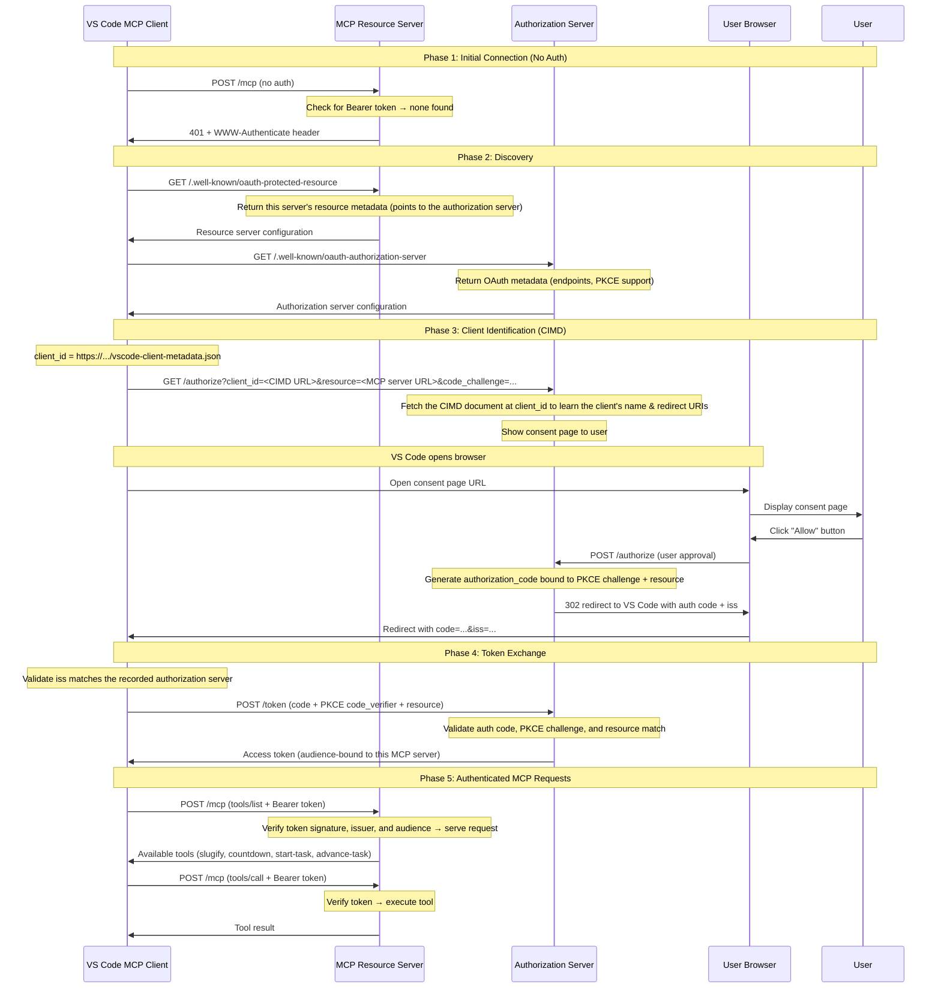

## OAuth 2.1 + PKCE Flow Sequence Diagram

Your MCP server plays the role of an OAuth 2.1 **resource server**: it verifies bearer tokens on incoming requests, but it doesn't issue them itself. A separate **authorization server** (which can be a service you run, or a hosted provider) owns login, consent, and token issuance.

A few things about this flow are worth calling out before the diagram:

- **No registration round trip.** VS Code identifies itself with a Client ID Metadata Document, a small JSON file it hosts at a fixed HTTPS URL, and that URL doubles as its `client_id`. The authorization server fetches that URL to learn the client's name and redirect URIs.
- **Every authorization and token request names the resource it's for**, using a `resource` parameter set to your MCP server's URL. Your server then verifies that any token presented to it was actually issued for it, not borrowed from some other service.
- **Token verification happens per request.** There's no session and nothing to look up by a session id, every `/mcp` call carries its own `Authorization: Bearer <token>` header and gets checked independently, the same as any other stateless request.



## Solution

The OAuth 2.1 + PKCE authorization server (discovery endpoints, CIMD-aware client identification, the consent page, and the token endpoint) is already implemented in the `src/auth/` folder, so this exercise runs entirely on your machine with no third-party account needed. You only need to integrate it into your existing HTTP server as a resource server that verifies the tokens that authorization server issues.

💡 A production MCP server typically points at a dedicated identity provider (Auth0, WorkOS, Stytch, or similar) rather than hosting its own authorization server. Running one locally here keeps the exercise self-contained; the resource-server code you're about to add, `requireBearerAuth` verifying a token's signature, issuer, and audience, is exactly the same regardless of which authorization server issued the token.

### Update HTTP Server (`src/http-server.ts`)

Add OAuth authentication to your existing HTTP server from step 5 with these changes:

```diff
#!/usr/bin/env -S node --import ./loader.mjs
import { createMcpExpressApp } from "@modelcontextprotocol/express";
import { toNodeHandler } from "@modelcontextprotocol/node";
import { createMcpHandler } from "@modelcontextprotocol/server";
import { createMcpServer } from "./mcp-server.js";
+ import { addOAuthToApp, requireBearerAuth } from "./auth/oauth-wrapper.js";

// Build the MCP handler: a fresh server instance serves every request
const handler = createMcpHandler(createMcpServer);
const node = toNodeHandler(handler);

// createMcpExpressApp gives you express.json() and DNS-rebinding
// protection (Host/Origin validation) already wired up
const app = createMcpExpressApp();

+ // Add OAuth discovery + authorization + token endpoints
+ addOAuthToApp(app);
+
+ // Require and verify a Bearer token on every /mcp request
- app.all('/mcp', (req, res) => void node(req, res, req.body));
+ app.all('/mcp', requireBearerAuth, (req, res) => void node(req, res, req.body));

app.listen(3000, () => {
  console.error('MCP HTTP server listening on http://127.0.0.1:3000/mcp');
});
```

**Key Changes:**

1. **Import**: bring in `addOAuthToApp` and `requireBearerAuth` from the OAuth wrapper
2. **`addOAuthToApp(app)`**: mounts the discovery, authorization, and token endpoints (`/.well-known/oauth-protected-resource`, `/.well-known/oauth-authorization-server`, `/authorize`, `/token`) that the sequence diagram above walks through
3. **`requireBearerAuth`**: a small piece of middleware that checks for a valid `Authorization: Bearer <token>` header, verifies it (signature, issuer, and that it was issued for this server as its audience), and returns `401` with a `WWW-Authenticate` header when it's missing or invalid
4. **`/mcp` route**: the handler itself is unchanged, `requireBearerAuth` runs in front of it, so no request reaches your tools without a valid token

That's it! The OAuth authentication system will now protect the `/mcp` route, checked fresh on every request, with no session or connection state involved.

## Next Steps

Congratulations! 🎉 You've completed the full MCP training journey.
You're now ready to build amazing MCP integrations!
